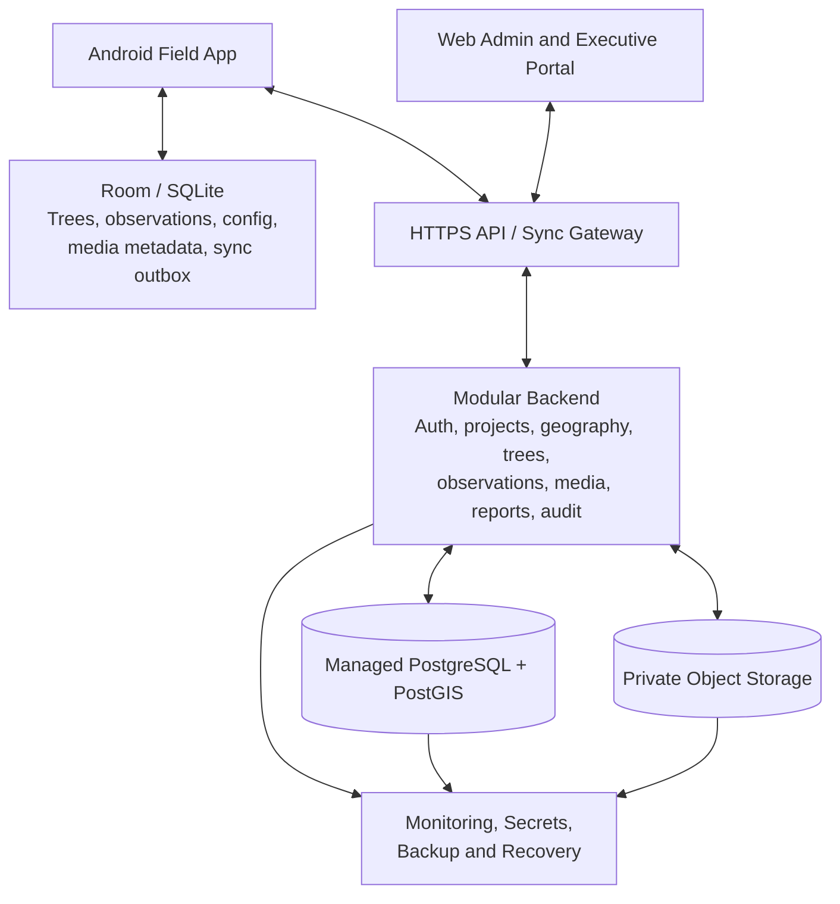
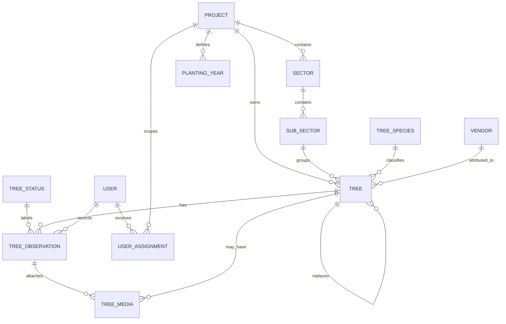

# Tree Management System — Technical Architecture

**Version:** 1.2  
**Date:** 19 October 2026  
**Status:** Proposed architecture for Phase 1

## 1. Purpose and architectural principles

This document describes the technical design for an offline-first, area-based reforestation tree management system.

### Non-negotiable principles
1. **Area-based, not tree-census based:** Administrators manage GPS reference coordinates and boundaries for sectors and sub-sectors. Each tree references an area. Individual tree GPS is not required.
2. **Physical label ID plus internal UUID:** The physical ID is configured from project/year/optional vendor and area codes plus a serial number. An internal UUID remains the stable system key.
3. **Offline-first writes:** The local database is the immediate write target for field operations. Cloud access is not required to save a tree or observation.
4. **Append-only observation history:** Tree condition changes are represented as dated observations, not destructive overwrites.
5. **Explicit replacement lineage:** Replanted trees get new identities and link to the original tree.
6. **Safe media lifecycle:** Local photographs are removed only after verified remote storage and record association.
7. **Managed cloud operations:** Use managed application hosting, database, object storage, monitoring, and backup services.
8. **Server-enforced security and validation:** UI restrictions are not a security boundary.

## 2. System context

### Clients
- **Android Field Officer app:** Kotlin, Jetpack Compose, Room/SQLite, WorkManager, CameraX.
- **Web administration portal:** React + TypeScript.
- **Web executive dashboard:** React + TypeScript, read-only permissions.

### Cloud services
- HTTPS API and sync gateway.
- Modular backend application.
- Managed PostgreSQL; use PostGIS for polygon geometry and spatial validation.
- Private object storage for photographs.
- Managed secrets, logs, metrics, alerts, and backups.

### Logical architecture

The diagram is logical. The backend should begin as a modular monolith, not a set of microservices.

## 3. Technology recommendations

| Layer | Recommendation | Rationale |
|---|---|---|
| Android | Kotlin + Jetpack Compose | Native Android access and maintainable UI |
| Local DB | Room/SQLite | Transactional, durable offline records |
| Background work | WorkManager | Persistent retryable network work |
| Camera | CameraX | Native photo capture |
| Location | Android location APIs | Admin-entered area points; no required tree GPS |
| Offline maps | MapLibre Native with licensed downloadable map data | Offline display of area boundaries and map background |
| Backend | NestJS + TypeScript | Modular API and validation |
| Database | Managed PostgreSQL | Relational integrity, reporting |
| Geospatial | PostGIS | Polygon storage and spatial queries |
| Web | React + TypeScript | Admin and executive interfaces |
| Media | Managed S3-compatible object storage | Durable photo storage |
| Hosting | Managed cloud application platform | Reduced operational burden |
| Observability | Managed logs, metrics and alerting | Operational visibility |

Provider selection should consider data residency, availability in the target region, pricing, backups, support, and contractual requirements. Map software does not itself supply licensed offline map data.

## 4. Core domain model

### 4.1 Entity relationships

### 4.2 Key tables

#### `projects`
`id UUID PK`, `name`, `short_code`, `description`, `location`, `start_date`, `end_date`, `status`, `created_at`, `updated_at`.

Short codes should be unique within the approved scope. Code changes affect future IDs by default and do not rewrite historic IDs.

#### `planting_years`
`id UUID PK`, `project_id FK`, `year_label`, `start_date`, `end_date`, `active`, `created_at`.

This is an explicit project configuration. Do not infer planting year from registration time. It may represent a calendar year or a named cohort, according to stakeholder policy.

#### `tree_id_schemes`
`id UUID PK`, `project_id FK`, `version`, `component_definition JSONB`, `separator`, `serial_width`, `serial_uniqueness_scope`, `active_from`, `active`.

The component definition describes ordered elements such as project code, planting year, vendor code, sector code, sub-sector code, and serial. Store the exact scheme version and component snapshot on each tree.

#### `sectors`
`id UUID PK`, `project_id FK`, `name`, `short_code`, `reference_latitude`, `reference_longitude`, `boundary_geometry GEOMETRY(POLYGON, 4326) NULL`, `active`.

#### `sub_sectors`
`id UUID PK`, `sector_id FK`, `name`, `short_code`, `reference_latitude`, `reference_longitude`, `boundary_geometry GEOMETRY(POLYGON, 4326) NULL`, `active`.

These are the authoritative geographical locations for the area-based approach. Reference coordinates and polygons represent areas, not individual trees. Validate latitude/longitude ranges, geometry validity, coordinate reference system, and parent/child relationships.

#### `trees`
`id UUID PK`, `physical_tree_id`, `physical_tree_id_normalized`, `serial_number`, `id_scheme_id FK`, `id_scheme_version`, `id_components_snapshot JSONB`, `project_id FK`, `planting_year_id FK`, `sector_id FK`, `sub_sector_id FK`, `species_id FK`, `current_status_id FK`, `vendor_id FK NULL`, `replaces_tree_id FK NULL`, `planted_on NULL`, `created_by FK`, `created_at`, `updated_at`, `revision`, `record_state`.

- `id` is the immutable internal UUID created on device.
- `physical_tree_id` is the full label, e.g. `T4L-2024-000001`.
- `physical_tree_id_normalized` supports duplicate detection under the approved case/spacing rules.
- No tree-level GPS column is required for Phase 1.
- `replaces_tree_id` links a replacement tree to its original tree. If multi-generation replacements are permitted, each replacement links to the immediately preceding tree and reports can traverse the lineage.

Apply a unique constraint to the normalised full physical ID in the approved scope. If uniqueness is per project, use a composite unique constraint with `project_id`; if global, use global uniqueness. Do not choose this scope implicitly.

#### `tree_observations`
`id UUID PK`, `tree_id FK`, `observed_status_id FK`, `observed_at`, `recorded_at`, `synced_at NULL`, `recorded_by FK`, `remarks`, `revision`, `is_amendment`, `amends_observation_id NULL`.

Observations are append-only for normal field use. Corrections create audited amendments. `observed_at`, `recorded_at`, and `synced_at` are separate to support delayed offline sync.

#### `tree_media`
`id UUID PK`, `tree_id FK`, `observation_id FK NULL`, `local_filename NULL`, `object_key NULL`, `checksum_sha256`, `byte_size`, `mime_type`, `upload_state`, `remote_verified_at NULL`, `association_verified_at NULL`, `created_at`, `captured_at`.

Media state is independent of tree sync state. Photos should normally attach to an observation; initial-registration photos can be linked to the initial observation. Store objects outside PostgreSQL.

#### Other tables
- `tree_species`
- `tree_statuses`
- `vendors`
- `users`
- `user_project_assignments` with optional sector/sub-sector scope
- `devices`
- `sync_batches`
- `sync_operations`
- `conflict_records`
- `audit_logs`
- `refresh_sessions` or equivalent secure session store

## 5. Configurable ID composition

### 5.1 Example
Base format:

`T4L-2024-000001`

Possible extended format:

`T4L-2024-V03-S02-SS04-000001`

The Administrator configures ordered components, separator, serial padding, required/optional components, and serial uniqueness scope.

### 5.2 Field workflow
1. Officer chooses project and planting year.
2. Officer selects sector/sub-sector and vendor if required by the configured scheme.
3. App assembles the prefix and presents it as read-only.
4. Officer enters only the trailing serial number.
5. App validates serial format and checks local duplicates.
6. App displays the complete ID for confirmation against the physical label.
7. App saves the tree using an internal UUID and stores the exact full physical ID and scheme version.

If a format changes, new records use the new version. Existing IDs are not silently rewritten. Corrections to a physical ID require an authorised, audited operation that preserves the prior value.

### 5.3 Offline uniqueness
A disconnected device cannot know about registrations on other disconnected devices. The app can detect duplicates only in its own database and cached records. The server's database unique constraint is authoritative at sync.

On collision:
- Do not overwrite the existing tree.
- Keep the incoming record and its media as a conflict.
- Return a clear conflict result to the device.
- Allow an Administrator to investigate and resolve with an audit trail.

If collisions are unacceptable operationally, pre-allocate serial ranges by project/year/vendor/area or officer. This is an operational prerequisite for guaranteed offline uniqueness.

## 6. Area-based geography

### Data capture
- Administrators enter sector and sub-sector reference coordinates.
- Administrators draw or import area polygons where required.
- Field Officers choose the correct sector and sub-sector during tree registration.
- Tree records inherit area context through their sub-sector relation.
- Individual tree GPS is not requested or required.

### Map handling
- Store polygons in PostGIS using an agreed coordinate reference system, normally WGS 84 / EPSG:4326 for interchange.
- Validate polygon geometry and parent/child relationships.
- Use licensed map data downloaded for assigned areas to render offline maps.
- Display sector/sub-sector boundaries and reference points, not invented individual tree pins.
- Optional out-of-area warnings can only be implemented if there is an individual tree coordinate or another independently verifiable area assignment. Do not calculate tree-in-polygon membership from absent tree coordinates.

## 7. Offline storage architecture

### Local Room database
Store:
- Projects and authorised assignments.
- Planting years and ID scheme versions.
- Sectors/sub-sectors and boundary geometry.
- Species and status reference data.
- Trees and observations.
- Media metadata.
- Outbox operations and sync cursors.
- Conflict and validation states.

### App-private file storage
Store unsynced photographs and downloaded map assets. Keep references in Room. Protect sensitive local content according to the risk assessment; use Android Keystore-backed keys for encryption material where encryption is implemented.

### Atomic local writes
Saving a tree/observation and its outbox operation must occur in one database transaction. This prevents an app crash from saving the record without queuing its sync operation.

## 8. Synchronisation protocol

### 8.1 Outbox operation
Each operation contains:
- `operation_id` UUID.
- `entity_type`, `entity_id`.
- `operation_type` (create/update/observation/amendment).
- `device_id`.
- `base_revision`.
- `client_recorded_at`.
- Payload and media references.
- Retry state and last error.

### 8.2 Sync cycle
1. Check connectivity and valid session.
2. Upload eligible media via secure, short-lived upload URL.
3. Verify object size and SHA-256 checksum.
4. Submit metadata/observation operations with idempotency keys.
5. Process item-level results: accepted, already processed, conflict, rejected.
6. Fetch authorised server changes using a server-issued cursor.
7. Apply safe configuration updates in local transactions.
8. Update sync states and report any conflicts.
9. Run media cleanup only for files meeting all deletion conditions.

### 8.3 Conflict policy
- New tree: idempotent create keyed by internal UUID, with unique physical-ID constraint.
- Duplicate physical ID: conflict; never overwrite.
- Observation: append-only event; deduplicate by observation UUID.
- Concurrent tree metadata edits: optimistic concurrency using `revision`; conflict requires review.
- Reference-data changes: versioned download and safe application.
- Deactivation/deletion: use tombstones or inactive flags so offline devices do not resurrect removed entities.
- Avoid blind last-write-wins.

### 8.4 Media deletion eligibility
Delete local photo only after:
1. Object storage confirms durable upload.
2. Checksum/size match.
3. Server confirms correct tree/observation association.
4. Local DB persists the verification acknowledgement.
5. No pending operation references the file.

Unsynced photos are never automatically purged. A crash between upload and acknowledgement must result in safe re-verification, not deletion.

## 9. API outline

All endpoints use `/api/v1`, HTTPS, authenticated requests, server-side authorisation, validation, and rate limiting.

| Method | Endpoint | Purpose |
|---|---|---|
| POST | `/auth/login` | Authenticate |
| GET | `/mobile/bootstrap` | Assigned projects, ID schemes, years, areas and reference data |
| GET/POST | `/projects` | List/create projects |
| POST | `/projects/{id}/planting-years` | Configure planting year |
| POST | `/projects/{id}/tree-id-schemes` | Create a new ID format version |
| POST | `/projects/{id}/sectors` | Create sector |
| POST | `/sectors/{id}/sub-sectors` | Create sub-sector |
| GET | `/tree-species` | Fetch species |
| GET | `/tree-statuses` | Fetch statuses |
| POST | `/trees` | Register tree |
| PATCH | `/trees/{id}` | Update allowed metadata with revision |
| POST | `/trees/{id}/observations` | Append observation |
| POST | `/trees/{id}/replacements` | Create linked replacement |
| POST | `/media/upload-sessions` | Create upload session |
| POST | `/sync/batches` | Submit operations |
| GET | `/sync/changes?cursor=...` | Fetch changes |
| GET | `/reports/summary` | Dashboard metrics |

The precise API contract should be specified in OpenAPI before implementation. Responses for sync batches must be item-level, not only batch-level.

## 10. Security

- TLS for all network communication.
- Server-side role, project and area authorisation.
- Argon2id or equivalent password hashing.
- Short-lived access tokens and secure refresh handling.
- Secrets stored in managed secrets service.
- Private object storage and expiring URLs.
- Audit events for configuration changes, ID corrections, replacements, conflict resolution, and user changes.
- Offline session expiry and explicit account revocation policy.
- Database private networking and least-privilege service accounts.
- Request, upload-size and rate limits.
- No public media links by default.

An offline device cannot receive revocation immediately. Define an acceptable offline access window and require revalidation when connectivity returns.

## 11. Managed cloud deployment

Recommended production components:
- Managed application runtime for API and background jobs.
- Managed PostgreSQL with private network, automated backups and point-in-time recovery if supported.
- Managed private object storage with versioning/lifecycle controls.
- Managed secrets service.
- Centralised logs, metrics, alerting and uptime checks.
- Separate development, staging, and production environments.
- CI/CD with reviewed migrations and rollback planning.
- Independent backups with separate permissions and, where justified, a separate failure domain.

Define RPO and RTO with stakeholders and test restoration of both database and media. A database backup alone does not back up photographs.

## 12. Observability and operations

Monitor:
- Sync success/failure rate and oldest pending operation.
- Photo upload failures and verification mismatches.
- Duplicate ID conflicts and unresolved conflicts.
- API latency, error rates, database capacity and storage use.
- Backup completion and restore-test results.
- Active devices, app versions, and last successful sync.
- Low-storage incidents reported by clients.

Provide user-facing error messages that explain the next action. Avoid exposing secrets or sensitive data in logs.

## 13. Testing strategy

### Unit tests
ID assembly and normalisation, serial rules, permission checks, replacement lineage, status calculations, sync idempotency, media deletion eligibility.

### Integration tests
Database uniqueness constraints, API authorisation, media association and checksum verification, revision conflicts, incremental change cursors, audit events.

### Android tests
Offline registration, process death, reboot persistence, duplicate checks, camera failure, low storage, offline map availability, interrupted upload, and cleanup safety.

### Field acceptance tests
Use actual target devices in no-network and intermittent-network conditions. Test two devices registering the same physical ID while disconnected. Confirm conflict handling and preservation of both submissions. Verify that no individual tree GPS is required.

## 14. Architecture decisions and open questions

### Decisions
- Native Android app and web admin/executive portal.
- Area-based geography: administrator-entered area coordinates and boundaries.
- No required tree-level GPS.
- Configurable tree ID format with officer-entered trailing serial.
- Explicit planting-year selection.
- Historical observation records.
- New ID and lineage for replacement trees.
- Managed cloud hosting and object storage.
- Verified media offloading and configurable local record cache.

### Must be confirmed before build
1. Full ID component order, separators, short-code rules and serial padding.
2. Serial uniqueness scope and serial range allocation policy.
3. Whether vendor, sector, and sub-sector components are required.
4. Whether planting year is a calendar year or named cohort.
5. Exact statuses and observation/photo requirements.
6. Offline session duration and revocation expectations.
7. Local cache duration and photo retention.
8. Cloud region/provider, RPO/RTO, expected record count, photo size and data volume.
